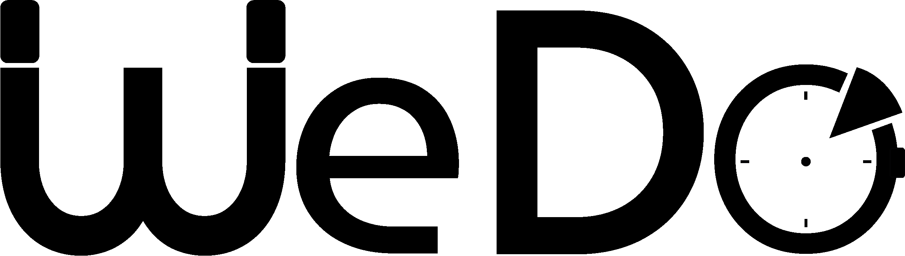

  <picture>
    <source media="(prefers-color-scheme: dark)" srcset="./assets/wedo-wordmark-light.png">
    
  </picture>

<h3 align="center">Il tempo delle persone, a pochi passi da te.</h3>

  <b>Human Time Economy</b> · servizi a domicilio, vicini, veri, adesso

---

## Meteo, non Uber

Le app di servizi ti promettono che qualcuno arriverà, sempre e comunque.
**WEDO fa un'altra cosa: ti mostra com'è il tuo quartiere in questo momento.**

Chi è libero. Quanto è vicino. Tra quanto può esserci.
Come guardare il meteo prima di uscire: niente promesse finte, solo la realtà, chiara.

> Non promettiamo onnipotenza.
> Promettiamo la miglior soluzione disponibile.

## Un gesto, e il quartiere risponde

**Detta**, **fotografa** o **scrivi** cosa ti serve: un rubinetto che perde, una luce che salta, un mobile da montare.
WEDO capisce di cosa hai bisogno, accende il radar intorno a te e ti porta dritto da chi può aiutarti, adesso o entro stasera.

Niente moduli infiniti. Niente attese al buio. Un tocco, e vedi le persone giuste.

## Per chi offre il proprio tempo

Elettricisti, idraulici, tuttofare, giardinieri, chi pulisce, chi monta, chi ripara.
Un semaforo dice al quartiere se ci sei. Le richieste arrivano. Rispondi tu, quando vuoi tu.

**Il tuo tempo vale. WEDO lo rende visibile.**

## In cosa crediamo

- **Trasparenza prima di tutto.** Mostriamo la copertura reale, mai una disponibilità inventata.
- **Le persone decidono.** La tecnologia propone, chi chiede e chi offre scelgono.
- **Vicinanza come valore.** Il servizio migliore è quello che può arrivare davvero.
- **Fiducia costruita col valore.** Non con le gabbie.

---

  Si parte da Milano. Il resto è questione di tempo. 
  © WEDO · Human Time Economy

